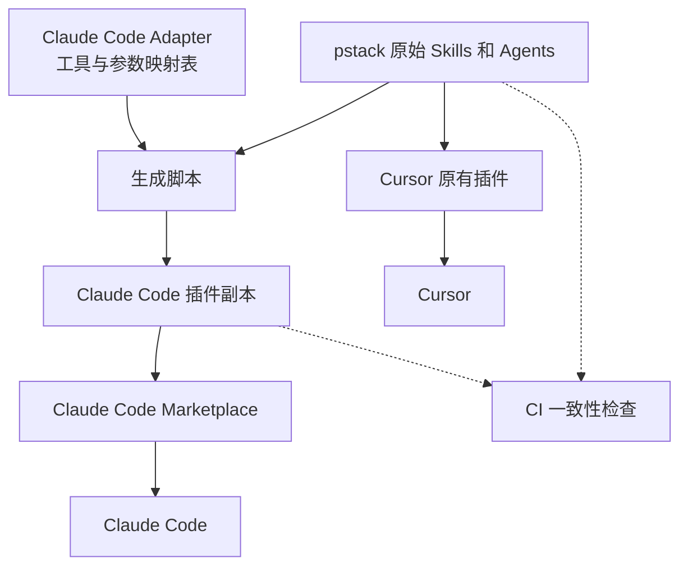
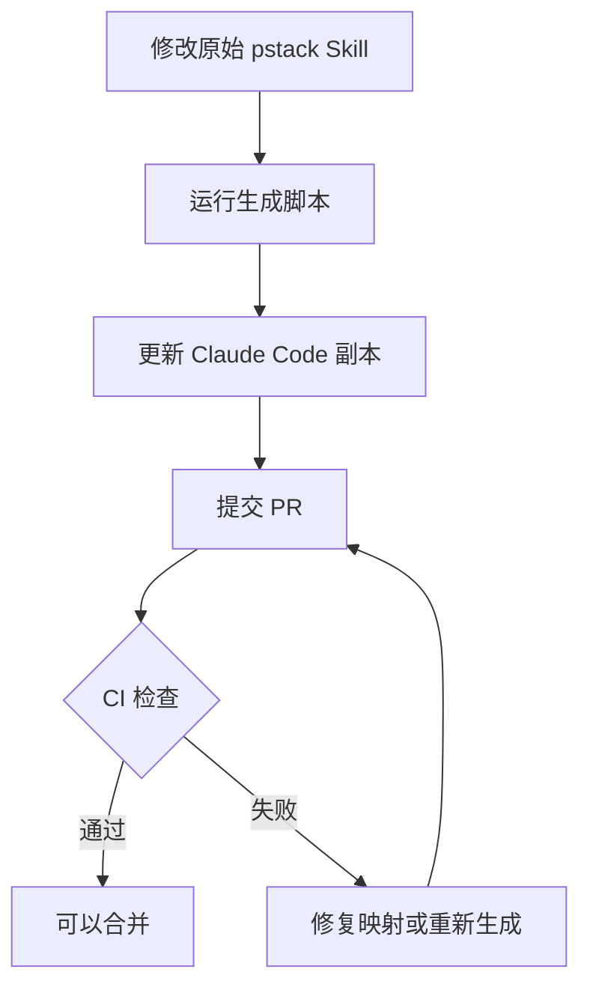

> [!NOTE]
> **来源**
>
> 原文链接：[cursor/plugins PR #637 — feat(pstack): install pstack in Claude Code from a generated tree](https://github.com/cursor/plugins/pull/637)
>
> 对应 commit：[`182f2ce`](https://github.com/cursor/plugins/commit/182f2ce414e83224915c190d2f63239c1608d0a5)（合入 main：2026-10-17 03:55，北京时间）
>
> PR 正文翻译和关键 diff 解读见[版本更新里的这一篇](https://pstack.ganhai.cloud/releases/claude-code-support/)。


10 月 17 日，poteto 提交的 [PR #637](https://github.com/cursor/plugins/pull/637) 正式合入了 `cursor/plugins` 主分支。

这次更新让 pstack 有了官方的 Claude Code 安装方式。

现在，在 Claude Code 中执行：

```bash
/plugin marketplace add cursor/plugins
/plugin install pstack@cursor-plugins
```

就可以安装 pstack。

安装之后，原本在 Cursor 里使用的 `/poteto-mode`，在 Claude Code 中需要写成 `/pstack:poteto-mode`。

不过，这次更新有个挺值得聊的地方。

**pstack 不就是一堆 Skills 吗？Claude Code 本来就支持 Skills，为什么还需要官方专门做一次适配？**

## pstack 不就是 Skill 吗？为什么不能直接用？

如果只是一个简单的 Skill，比如告诉 Agent 怎么写 Git Commit、怎么检查代码风格，确实没什么需要适配的。

毕竟 Skill 本质上就是一个包含 `SKILL.md` 的目录。模型读完里面的指令，再按照要求执行。

但 pstack 不太一样。

它虽然也是用 Skills 组织起来的，但很多 Skill 并不只是告诉模型应该怎么思考，还会直接指挥 Agent 调用工具、创建子 Agent、选择模型，甚至操作宿主程序提供的功能。

而 pstack 最初就是为 Cursor 开发的。

所以，它的很多指令实际上写的是 Cursor 的语言。

举个最简单的例子。

pstack 里需要创建子 Agent 时，使用的是 Cursor 的 `Task` 工具。

但在 Claude Code 中，对应的工具叫 `Agent`。

再比如，Cursor 使用 `AskQuestion` 向用户提问，Claude Code 对应的是 `AskUserQuestion`。

还有模型配置。

Cursor 里的 pstack 可以指定：

```yaml
model: claude-opus-5-5-xhigh
```

但 Claude Code 的模型参数不是这么写的。按照这次官方适配文件的规则，需要拆成：

```yaml
model: opus
effort: xhigh
```

这还只是比较容易处理的部分。

pstack 里还用到了 Cursor 的云端 Agent、Bugbot、Automations，以及 `.cursor/rules/` 等目录和规则。

这些东西在 Claude Code 里，要么名字不一样，要么根本没有对应功能。

所以问题并不是 Claude Code 读不了 `SKILL.md`。

**而是读得懂指令，不代表能按照指令调用正确的工具。**

如果直接把 Cursor 版本的 pstack 扔给 Claude Code，模型可能知道自己应该做什么，却不知道该怎么在当前环境里完成。

理解了这个问题，也就知道应该从哪里下手了。

## 怎么支持 Claude Code？其实有两条路

既然问题出在不同工具的接口和能力不一致，那最直接的办法，就是修改 Skill 本身。

比如在 Skill 里判断当前运行的是 Cursor 还是 Claude Code，再分别使用对应的工具名、模型参数和文件路径。

这样就可以维护一套同时兼容多个宿主的 Skills。

实际上，官方仓库里也有一个走这条路线的 [PR #629](https://github.com/cursor/plugins/pull/629)。

但这次最终合入的 PR #637，没有选择直接修改原来的 Skills。

它采用的是另一种思路：

**原来的 pstack 保持不变，额外生成一份给 Claude Code 使用的插件。**

这样一来，Cursor 用户继续使用原来的版本，不需要承担跨平台改造带来的行为变化。

而 Claude Code 用户，则通过自己的插件市场，安装一份经过适配的副本。

整个方案最关键的地方，是它没有去逐个重写 Skill 里的 Cursor 指令。

它做了一张工具映射表，让模型在运行 Skill 时，自己完成转换。

## 官方具体是怎么实现的？

这次 PR 主要增加了三个东西：

- 一份 Claude Code 适配说明文件（adapter）
- 一个生成 Claude Code 插件副本的脚本
- 一套保证副本和原始 Skills 同步的 CI 检查

先看整体结构。




### 第一步：写一份 Claude Code 的翻译表

官方新增了一个文件：

`pstack/docs/harness/claude-code.md`

它的作用很简单：告诉模型，遇到 Cursor 的工具和参数时，在 Claude Code 里应该怎么处理。

比如：

| Cursor | Claude Code |
|---|---|
| `Task` | `Agent` |
| `AskQuestion` | `AskUserQuestion` |
| `generalPurpose` | `general-purpose` |
| `poteto-agent` | `pstack:poteto-agent` |
| `.cursor/skills/` | `.claude/skills/` |
| `.cursor/rules/*.mdc` | `CLAUDE.md` 或 `AGENTS.md` |


对于没有对应功能的部分，比如 Bugbot、Cursor Automations，适配文件会要求模型说明情况，并跳过相关步骤。

这份文件只有 50 行，却是整个方案的核心。

它没有让脚本把所有 Cursor 工具名直接替换掉，而是把转换规则集中放在一个地方。

### 第二步：自动生成 Claude Code 插件

有了翻译表，接下来就是让 Claude Code 的 Skills 能够用上它。

官方新增了一个 Node.js 脚本：

`scripts/generate-pstack-harness-trees.mjs`

这个脚本会扫描原始的 pstack Skills，找出哪些 Skill 使用了 Cursor 专属的工具、参数或调用方式。

在这次 PR 中，54 个 Skills 里，有 21 个需要添加适配提示。

生成脚本会在这些 Skill 的标题下面，自动插入一句话：

```markdown
In Claude Code, read [the Claude Code adapter]
(../../docs/harness/claude-code.md)
once per session before you follow this skill.
```

意思就是：

在 Claude Code 中执行这个 Skill 之前，先读取 Claude Code 的适配文件，每个会话读一次。

注意，这里并没有重写原来的 Skill 正文。

比如原来写的是调用 `Task`，生成后的 Skill 仍然写着 `Task`。

只不过模型在执行时，会先读 adapter，知道在 Claude Code 里应该使用 `Agent`。

这就是整个方案最巧妙的地方：不需要为每个平台重新维护一整套 Skill 逻辑。

生成器还会处理插件清单和文件链接，最后生成一个完整的目录：

```text
harness/
└── pstack/
    └── claude-code/
        ├── skills/
        ├── agents/
        ├── docs/harness/claude-code.md
        ├── .claude-plugin/plugin.json
        ├── plugin.json
        └── LICENSE
```

Claude Code 的插件市场会直接指向这个目录，而不是原来的 `pstack/`。

为什么要把生成结果直接提交到 Git 仓库？

因为 Claude Code 安装插件时，只会复制插件目录，不会帮你执行构建脚本。

所以官方需要提前把副本生成好。

### 第三步：用 CI 保证两份内容不会跑偏

看到这里，可能又有一个问题。

原来的 pstack 一直在更新。现在多了一份 Claude Code 副本，以后每次修改 Skill，难道都要手动同步两遍？

这显然不太现实。

所以官方在 CI 中增加了一项检查：

```bash
node scripts/generate-pstack-harness-trees.mjs --check
```

它会根据最新的原始 Skills 重新计算一遍，看看仓库里提交的 Claude Code 副本是不是应该长这样。

如果有人修改了原始 Skill，却忘了重新生成副本，CI 就会失败。

如果 Skill 用到了新的 Cursor 专属工具，但 adapter 没有对应的映射规则，也会失败。

如果生成的副本里存在指向未包含文件的相对链接，同样会被检查出来。

这样，后续维护者只需要修改原始 pstack，然后运行生成脚本：

```bash
node scripts/generate-pstack-harness-trees.mjs
```

再把生成结果一起提交即可。




所以，这次官方采用的其实是一种很典型的工程做法：

**只维护一份源文件，其他平台需要的内容都通过脚本生成，再用 CI 保证一致性。**

## 现在 Claude Code 里的 pstack 和 Cursor 一样了吗？

还不能完全这么说。

这次更新解决的主要是安装路径，以及不同工具之间的适配问题。

它并没有让 Claude Code 获得 Cursor 的所有功能。

比如 Cursor Automations、Bugbot 和云端 Agent，并不会因为安装了 pstack 就出现在 Claude Code 里。

还有 `/setup-pstack`。

它原本会在 Cursor 中生成 `pstack-models.mdc`，用于配置不同角色使用的模型。

但 Claude Code 不加载 `.mdc` 文件，所以这次 adapter 明确要求：在 Claude Code 中执行这个配置流程时，说明无法写入对应规则，然后停止。

另外，像 `/interrogate` 这种依赖不同模型交叉评审的 Skill，在 Claude Code 中也会受到模型选择方式的影响。

官方的处理办法是：遇到无法使用的非 Claude 模型，就退回当前会话模型，并向用户说明。

因此，**官方支持 Claude Code，不等于所有 Skill 在两个平台上的执行效果都完全相同。**

不过，至少现在 Claude Code 用户已经有了一条官方提供、可以持续跟随官方更新的安装路径。

## 最后

我觉得这次更新有意思的地方，不只是 pstack 终于能在 Claude Code 里安装了。

而是它展示了一种让原本绑定某个 Agent 工具的 Skills，逐步支持其他工具的方式。

原始 Skill 不动。

不同平台的差异集中写在 adapter 里。

需要的插件副本由脚本生成。

最后通过 CI 确保它们不会失去同步。

这套方案当然也有代价。比如模型执行时需要多读一份 adapter，某些宿主专属能力无法完全转换，而且新增平台时仍然需要维护新的映射规则。

但至少它避免了在几十个 Skill 里到处写平台判断。

对于正在使用 pstack 的人来说，这次更新也意味着，不必再把 Cursor 当作唯一的运行入口了。

---

### 相关链接

**官方 PR：** [cursor/plugins #637 — feat(pstack): install pstack in Claude Code from a generated tree](https://github.com/cursor/plugins/pull/637)

**poteto 的 PR 中文译文：** [无版本号更新：pstack 支持 Claude Code（PR #637 原文翻译与关键代码解读）](https://pstack.ganhai.cloud/releases/claude-code-support/)

**本站此前的跨宿主说明：** [Claude Code / Codex 能用吗](./beyond-cursor.md)

**pstack 中文站：** https://pstack.ganhai.cloud/

## 彩蛋

这个 PR 里其实一度是支持 Codex 的，但相关的 commit 不知道什么原因又给删掉了，咱也不知道为什么。

PR 分支上原本有一整套 Codex adapter 和 Codex 插件副本，后来被 commit [`e84046f`](https://github.com/cursor/plugins/commit/e84046f96b857f4070355e491cfc4bc7759c2ba6)（drop Codex as a harness and keep Claude Code only）删掉了，在 [PR #637](https://github.com/cursor/plugins/pull/637) 的提交记录里能看到。


